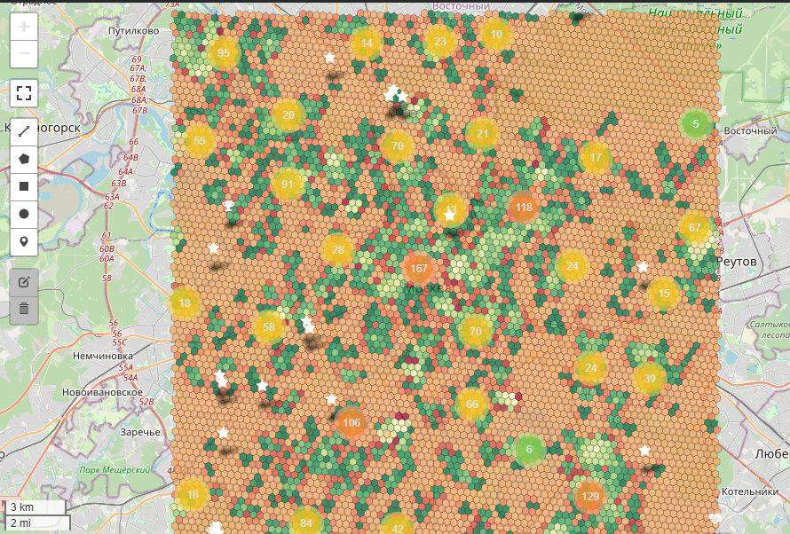
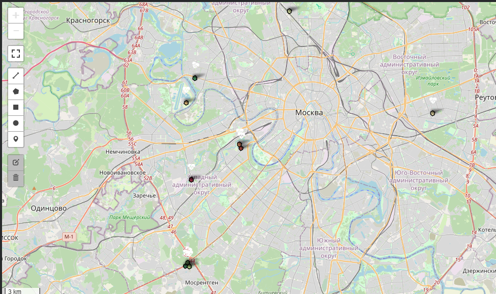

# 🏋️‍♂️ Геомаркетинговое исследование территорий: Поиск оптимальных локаций для открытия фитнес-центра

> **Использованы:** Python, OpenStreetMap, H3, Scikit-learn, Leafmap, Google Colab

Этот репозиторий содержит полный аналитический пайплайн для определения оптимальных локаций для открытия нового **фитнес-центра** с использованием методов геоанализа, машинного обучения и интерактивной визуализации. Проект был реализован в **Google Colab** и демонстрирует, как превратить открытые геоданные в обоснованное бизнес-решение.

---

## 📌 Описание проекта

В условиях высокой конкуренции на рынке фитнес-услуг, выбор правильной локации — ключевой фактор успеха. Этот проект решает задачу: **"Где открыть новый фитнес-центр, чтобы максимизировать потенциал прибыли, минимизировав конкуренцию?"**

Мы не просто ищем места без конкурентов — мы **обучаем модель** на основе реальных данных о расположении существующих фитнес-центров, чтобы понять, **какие характеристики среды** (офисы, жилье, транспорт, парки и т.д.) делают локацию привлекательной для бизнеса. Затем мы **комбинируем** эту привлекательность с уровнем конкуренции, чтобы получить итоговый показатель потенциала.

---

## 🚀 Как это работает? (Архитектура пайплайна)

Проект состоит из 6 этапов:

### 1. 🌍 Сбор данных из OpenStreetMap
- Используем библиотеку `osmnx` для загрузки:
  - **Существующие фитнес-центры** (целевая переменная).
  - **Инфраструктура**: офисы, магазины, остановки, парки, жилые дома, дороги, пешеходные зоны и др.
- Область интереса (ROI) задается вручную через интерактивную карту в Colab (или по умолчанию — часть Москвы).

### 2. 🧱 Агрегация данных на сетке H3
- Разбиваем территорию на **гексагональные ячейки** (разрешение H3-9, ~350 м) для равномерного и масштабируемого анализа.
- Используем `h3` и `geopandas` для создания сетки и проецирования данных в метрическую систему координат (EPSG:3857).

### 3. 🧠 Feature Engineering (Инженерия признаков)
Для каждой ячейки H3 рассчитываются **33 признака**, включая:
- **Количество** объектов в ближнем (150 м) и среднем (400 м) радиусе.
- **Площадь** полигональных объектов (офисы, жилье, парки).
- **Длина** линейных объектов (пешеходные дорожки, дороги).
- **Конкуренция**: количество фитнес-центров в ближнем/среднем радиусе.

### 4. 🤖 Машинное обучение: Оценка привлекательности места
- **Целевая переменная**: `has_fitness_center` — бинарный признак (есть ли хотя бы один фитнес-центр в ближнем радиусе ячейки).
- **Модели**: RandomForestClassifier и GradientBoostingClassifier.
- **Результат**: Модель предсказывает **вероятность привлекательности среды** (`environment_suitability`) для каждого гексагона.
- **Важность признаков**: Выявлены ключевые факторы (например, близость офисов, жилья и остановок).

### 5. 🎯 Расчет итогового потенциала
- **Интегральный показатель `opening_potential`** рассчитывается по формуле:
  ```
  opening_potential = W_env * environment_suitability + W_comp * (1 - normalized_competition)
  ```
  - `W_env = 0.7` — вес привлекательности среды.
  - `W_comp = 0.3` — вес отсутствия конкуренции.
  - `normalized_competition` — нормализованное количество фитнес-центров в среднем радиусе.
- Локации категоризируются на 5 уровней: *Очень низкий, Низкий, Средний, Высокий, Очень высокий*.

### 6. 🗺️ Интерактивная визуализация
- **Основная карта** (Leafmap):
  - Тепловая карта потенциала (`opening_potential`) по гексагонам.
  - Маркеры всех существующих фитнес-центров.
  - Топ-20 рекомендуемых локаций **без ближайших конкурентов** (с иконками 🌟 и 🏆).
- **Отдельная карта топ-10 локаций**:
  - Фокус на лучших вариантах.
  - Подробные popup с данными: потенциал, привлекательность, инфраструктура, координаты.
  - Вывод координат в консоль для экспорта.

---

## 🛠️ Технологии и библиотеки

| Категория             | Библиотеки                                                                                         |
| --------------------- | -------------------------------------------------------------------------------------------------- |
| **Геоанализ**         | `geopandas`, `osmnx`, `h3`, `shapely`, `leafmap`, `ipyleaflet`                                     |
| **Машинное обучение** | `scikit-learn` (RandomForest, GradientBoosting, StandardScaler, train_test_split, cross_val_score) |
| **Анализ данных**     | `pandas`, `numpy`, `matplotlib`, `seaborn`, `kneed`                                                |
| **Среда**             | Google Colab                                                                                       |

> Все зависимости автоматически устанавливаются при запуске в Colab.

---

## 📂 Структура репозитория

```
fitness-location-analysis/
├── README.md                     # Этот файл
├── fitness_location_analysis.ipynb  # Главный Jupyter Notebook (ваш блокнот)
└── data/                         # (опционально) Папка для сохранения результатов
    ├── fitness_centers.geojson
    └── h3_potential_results.geojson
```

---

## ▶️ Как запустить проект

1. Откройте [Google Colab](https://colab.research.google.com/).
2. Загрузите файл `fitness_location_analysis.ipynb`.
3. Запустите все ячейки по порядку.
4. **На шаге 1.4** на интерактивной карте **нарисуйте прямоугольник** вокруг интересующей вас территории (или используйте значение по умолчанию).
5. **Дождитесь завершения всех расчетов** (особенно Шаг 2 и Шаг 4 — они могут занимать 10–30 минут в зависимости от размера территории).
6. На последних шагах вы увидите **интерактивные карты** с результатами.

> 💡 **Совет**: Для лучшей производительности в Colab используйте **GPU Runtime** (Runtime → Change runtime type → GPU), хотя для этого проекта он не обязателен.

---

## 📊 Пример вывода

На итоговой карте вы увидите:

- **Тепловую карту**: Красные гексагоны — низкий потенциал, зеленые — высокий.
- **Красные маркеры**: Существующие фитнес-центры (конкуренты).
- **Зеленые звезды (🌟)**: Топ-20 рекомендуемых локаций без конкурентов.
- **Зеленый трофей (🏆)**: Топ-3 лучших локации.
- **Popup-окна**: При наведении — детальная статистика: потенциал, число офисов, жилья, парков и т.д.
 
 Карта с фокусом на топ-K локациях
 

---

## ✅ Результаты и выводы

- Модель показала **высокую точность (ROC AUC > 0.99)**, что подтверждает, что расположение фитнес-центров не случайно, а определяется четкими паттернами инфраструктуры.
- **Ключевые факторы привлекательности**: близость офисов, жилых домов, остановок общественного транспорта и пешеходных путей.
- **Оптимальная стратегия**: Искать локации с **высокой привлекательностью среды** и **минимальной конкуренцией** — это дает наилучший баланс между спросом и возможностью выделиться.
- Предложенный подход **не ограничен фитнес-центрами** — его можно легко адаптировать под аптеки, магазины, рестораны, зарядные станции и т.д.

---

## 📈 Возможные улучшения (для ВКР или дальнейшего развития)

- ✅ **Интеграция с реальными данными**: Плотность населения, доходы, стоимость аренды.
- ✅ **Анализ доступности**: Расчет зон изохрон (как далеко можно дойти за 5/10/15 минут).
- ✅ **Модель регрессии**: Предсказание **количество посетителей** или **оборота**, а не бинарную классификацию.
- ✅ **Автоматизация**: Создание веб-приложения на **Streamlit** для интерактивного выбора ROI и получения отчета без кода.
- ✅ **Пространственная регрессия (GWR)**: Учет локальных различий в влиянии факторов.
- ✅ **Анализ видимости**: Оценка, насколько хорошо локация видна с улиц.

---

## 📎 Использование в других отраслях

Этот подход универсален. Просто замените:
- **Целевой тег** (`leisure=fitness_centre`) на нужный (например, `shop=supermarket`).
- **Факторы привлекательности** (например, для аптеки важны жилье и остановки, но не офисы).
- **Веса** в формуле потенциала.

Подходит для:
- 🛒 Розничные магазины
- 🏥 Аптеки, поликлиники
- ☕ Кофейни, рестораны
- ⚡ Зарядные станции для электромобилей
- 🏢 Пункты выдачи заказов (ПВЗ)

---

## 👤 Автор

**Денис Дробышев**  
Бакалавр, специализация: Прикладная информатика \ Анализ данных, геоинформационные системы  

---

## 📜 Лицензия

Этот проект распространяется под лицензией MIT — свободно для обучения, исследований и некоммерческого использования.

---

> ✨ **Спасибо за внимание!**  
> Этот проект — не просто код, а **инструмент для принятия решений**. Используйте его, чтобы открывать бизнес не наугад, а на основе данных.